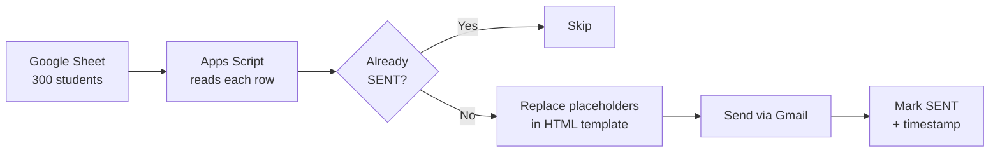

# 📧 Mail Merge Guide — SSC 2027 Briefing Invite

Send personalized HTML emails to 300 students using **Google Apps Script + Gmail**. Free, no sign-ups needed.

---

## Step 1: Create the Google Sheet

1. Go to [sheets.google.com](https://sheets.google.com) → **Blank spreadsheet**
2. Name it `SSC2027 Mail List`
3. Set up these columns in **Row 1**:

| A | B | C | D |
|---|---|---|---|
| **Email** | **FirstName** | **Status** | **Timestamp** |

4. Paste your 300 student emails + names in columns A and B (starting from Row 2)

**Example:**

| Email | FirstName | Status | Timestamp |
|-------|-----------|--------|-----------|
| rahul@parul.edu | Rahul | | |
| priya@parul.edu | Priya | | |

> [!IMPORTANT]
> Leave columns C and D **empty** — the script fills them automatically to track which emails were sent.

---

## Step 2: Open Apps Script

1. In your Google Sheet, click **Extensions → Apps Script**
2. Delete any existing code in the editor
3. Paste the entire script from **Step 3** below
4. Click **💾 Save** (or Ctrl+S)

---

## Step 3: The Script

Copy-paste this entire script:

```javascript
// ============================================================
//  SSC 2027 Briefing Invite — Mail Merge Script
//  Sends personalized HTML emails from a Google Sheet
// ============================================================

// ⬇️ EDIT THESE VALUES ⬇️
const CONFIG = {
  TIME: "2:00 PM",                           // e.g. "2:00 PM"
  VENUE: "Parul University, Main Auditorium", // e.g. "Room 301, Block A"
  CONFIRM_LINK: "https://forms.gle/YOUR_FORM_LINK",  // Google Form / RSVP link
  CONTACT: "Swift Coding Club Instagram @swiftcodingclub",
  SENDER_NAME: "Swift Coding Club · Parul University",

  // Your GitHub Pages base URL for hosted images
  IMAGE_BASE: "https://manav-mnv.github.io/mail_ssc27",
};

// ============================================================
//  Main function — Run this to send emails
// ============================================================
function sendBriefingEmails() {
  const sheet = SpreadsheetApp.getActiveSpreadsheet().getActiveSheet();
  const data = sheet.getDataRange().getValues();
  const headerRow = data[0];

  // Find column indexes
  const emailCol = headerRow.indexOf("Email");
  const nameCol = headerRow.indexOf("FirstName");
  const statusCol = headerRow.indexOf("Status");
  const timestampCol = headerRow.indexOf("Timestamp");

  if (emailCol === -1 || nameCol === -1) {
    SpreadsheetApp.getUi().alert("❌ Could not find 'Email' or 'FirstName' columns. Check your header row.");
    return;
  }

  const htmlTemplate = getEmailHtml();
  let sentCount = 0;
  let skipCount = 0;
  let errorCount = 0;

  for (let i = 1; i < data.length; i++) {
    const email = (data[i][emailCol] || "").toString().trim();
    const firstName = (data[i][nameCol] || "").toString().trim();
    const status = (data[i][statusCol] || "").toString().trim();

    // Skip empty rows or already-sent
    if (!email || status === "SENT") {
      skipCount++;
      continue;
    }

    // Personalize the HTML
    let html = htmlTemplate
      .replace(/\{\{FirstName\}\}/g, firstName || "Student")
      .replace(/\{\{TIME\}\}/g, CONFIG.TIME)
      .replace(/\{\{VENUE\}\}/g, CONFIG.VENUE)
      .replace(/\{\{CONFIRM_LINK\}\}/g, CONFIG.CONFIRM_LINK)
      .replace(/\{\{CONTACT\}\}/g, CONFIG.CONTACT);

    try {
      GmailApp.sendEmail(email, "You're invited: Swift Student Challenge 2027 briefing, 28 Nov", "", {
        htmlBody: html,
        name: CONFIG.SENDER_NAME,
      });

      // Mark as sent
      sheet.getRange(i + 1, statusCol + 1).setValue("SENT");
      sheet.getRange(i + 1, timestampCol + 1).setValue(new Date());
      sentCount++;

      // Small delay to avoid rate limits
      Utilities.sleep(500);

    } catch (e) {
      sheet.getRange(i + 1, statusCol + 1).setValue("ERROR: " + e.message);
      errorCount++;
    }
  }

  SpreadsheetApp.getUi().alert(
    `✅ Done!\n\nSent: ${sentCount}\nSkipped: ${skipCount}\nErrors: ${errorCount}`
  );
}

// ============================================================
//  Send a TEST email to yourself first
// ============================================================
function sendTestEmail() {
  const myEmail = Session.getActiveUser().getEmail();
  const html = getEmailHtml()
    .replace(/\{\{FirstName\}\}/g, "Test Student")
    .replace(/\{\{TIME\}\}/g, CONFIG.TIME)
    .replace(/\{\{VENUE\}\}/g, CONFIG.VENUE)
    .replace(/\{\{CONFIRM_LINK\}\}/g, CONFIG.CONFIRM_LINK)
    .replace(/\{\{CONTACT\}\}/g, CONFIG.CONTACT);

  GmailApp.sendEmail(myEmail, "[TEST] You're invited: SSC 2027 briefing, 28 Nov", "", {
    htmlBody: html,
    name: CONFIG.SENDER_NAME,
  });

  SpreadsheetApp.getUi().alert("✅ Test email sent to " + myEmail + "\nCheck your inbox!");
}

// ============================================================
//  Email HTML template (uses GitHub Pages hosted images)
// ============================================================
function getEmailHtml() {
  const IMG = CONFIG.IMAGE_BASE;
  return `<!DOCTYPE html>
<html lang="en">
<head>
<meta charset="utf-8">
<meta name="viewport" content="width=device-width, initial-scale=1">
<meta name="color-scheme" content="light">
<meta name="supported-color-schemes" content="light">
<title>You're invited: Swift Student Challenge 2027 briefing, 28 Nov</title>
<style>
  body { margin:0; padding:0; background:#e6d9bf; }
  a { text-decoration:none; }
  .serif { font-family:'Playfair Display',Georgia,'Times New Roman',serif; }
  .sans { font-family:-apple-system,BlinkMacSystemFont,'SF Pro Text','Helvetica Neue',Helvetica,Arial,sans-serif; }
  @media (max-width:620px) {
    .wrap { width:100% !important; }
    .pad { padding-left:24px !important; padding-right:24px !important; }
    .h1 { font-size:34px !important; line-height:38px !important; }
    .date { font-size:56px !important; line-height:58px !important; }
    .logo { display:block !important; width:100% !important; padding:3px 0 !important; text-align:center !important; }
    .col { display:block !important; width:100% !important; padding:10px 0 !important; }
  }
</style>
</head>
<body style="margin:0;padding:0;background:#e6d9bf;">

<div style="display:none;max-height:0;overflow:hidden;opacity:0;color:transparent;">
  28 November. See what you can build for Apple's Swift Student Challenge 2027, and how we'll help you apply.&nbsp;&zwnj;&nbsp;&zwnj;&nbsp;&zwnj;
</div>

<table role="presentation" width="100%" cellpadding="0" cellspacing="0" border="0" style="background:#e6d9bf;">
<tr><td align="center" style="padding:28px 12px;">

<table role="presentation" class="wrap" width="600" cellpadding="0" cellspacing="0" border="0" style="width:600px;max-width:600px;background:#f8f1e1;border-radius:18px;overflow:hidden;">

  <!-- 1. BEIGE: logo row -->
  <tr><td class="pad" style="padding:24px 36px;background:#f8f1e1;">
    <table role="presentation" width="100%" cellpadding="0" cellspacing="0" border="0">
      <tr>
        <td class="logo" align="center" valign="middle" style="padding:4px 6px;">
          
        </td>
        <td class="logo" align="center" valign="middle" style="padding:4px 6px;">
          
        </td>
        <td class="logo" align="center" valign="middle" style="padding:4px 6px;">
          <table role="presentation" cellpadding="0" cellspacing="0" border="0" style="display:inline-block;border:1.5px solid #2b1a1a;border-radius:6px;padding:4px 10px;">
            <tr><td class="sans" align="center" style="font-size:10px;line-height:13px;font-weight:600;color:#2b1a1a;white-space:nowrap;">&#63743; Authorised<br>Training Centre</td></tr>
          </table>
        </td>
        <td class="logo" align="center" valign="middle" style="padding:4px 6px;">
          
        </td>
      </tr>
    </table>
  </td></tr>

  <!-- 2. MAROON: hero -->
  <tr><td class="pad" align="center" style="padding:48px 36px 44px 36px;background:#8a1c1c;">
    <table role="presentation" cellpadding="0" cellspacing="0" border="0"><tr>
      <td class="sans" style="border:2px solid #f3e6c9;border-radius:999px;padding:7px 20px;font-size:13px;font-weight:700;letter-spacing:0.14em;text-transform:uppercase;color:#f3e6c9;">You're invited</td>
    </tr></table>
    <div class="serif h1" style="padding-top:24px;font-size:44px;line-height:48px;font-weight:400;color:#f8f1e1;">
      Apple's Global<br><span style="font-weight:800;">Swift Student<br>Challenge 2027</span>
    </div>
    <div class="sans" style="padding-top:20px;font-size:17px;line-height:26px;color:#ecd9b8;">
      Hi {{FirstName}}, thank you for registering. Join our one-time briefing to learn what you can build, the new rules, and how we'll take you from idea to submission.
    </div>
  </td></tr>

  <!-- 3. BEIGE: date + button -->
  <tr><td class="pad" align="center" style="padding:40px 36px 8px 36px;background:#f8f1e1;">
    <div class="sans" style="font-size:13px;letter-spacing:0.16em;text-transform:uppercase;font-weight:700;color:#8a1c1c;">Briefing session</div>
    <div class="serif date" style="font-size:76px;line-height:78px;font-weight:800;color:#8a1c1c;padding-top:6px;">28 Nov 2026</div>
    <div class="sans" style="font-size:19px;line-height:26px;font-weight:700;color:#2b1a1a;padding-top:8px;">Saturday &nbsp;&middot;&nbsp; {{TIME}}</div>
    <div class="sans" style="font-size:16px;line-height:24px;color:#6b5a52;padding-top:2px;">{{VENUE}}</div>
    <table role="presentation" cellpadding="0" cellspacing="0" border="0" style="margin-top:26px;"><tr>
      <td align="center" style="background:#8a1c1c;border-radius:999px;">
        <a href="{{CONFIRM_LINK}}" class="sans" style="display:inline-block;padding:15px 40px;font-size:17px;font-weight:700;color:#f8f1e1;">I'll be there</a>
      </td></tr></table>
  </td></tr>

  <!-- 4. MAROON: proof strip -->
  <tr><td class="pad" align="center" style="padding:36px 36px;background:#8a1c1c;margin-top:36px;">
    <div class="sans" style="font-size:13px;letter-spacing:0.16em;text-transform:uppercase;font-weight:700;color:#f3e6c9;padding-bottom:18px;">From Parul University to Apple's global stage</div>
    <table role="presentation" width="100%" cellpadding="0" cellspacing="0" border="0">
      <tr>
        <td class="col" width="50%" align="center" style="padding:0 8px;">
          <div class="serif" style="font-size:56px;line-height:58px;font-weight:800;color:#f8f1e1;">40</div>
          <div class="sans" style="font-size:14px;line-height:20px;color:#ecd9b8;">apps submitted from Parul University in 2026</div>
        </td>
        <td class="col" width="50%" align="center" style="padding:0 8px;">
          <div class="serif" style="font-size:56px;line-height:58px;font-weight:800;color:#f8f1e1;">1</div>
          <div class="sans" style="font-size:14px;line-height:20px;color:#ecd9b8;">Top 350 global winner: Praneel Pandey, B.Tech CSE</div>
        </td>
      </tr>
    </table>
  </td></tr>

  <!-- 5. BEIGE: what we'll cover -->
  <tr><td class="pad serif" style="padding:40px 36px 4px 36px;background:#f8f1e1;font-size:28px;line-height:34px;font-weight:700;color:#8a1c1c;">
    What we'll cover
  </td></tr>
  <tr><td class="pad" style="padding:8px 36px 0 36px;background:#f8f1e1;">
    <table role="presentation" width="100%" cellpadding="0" cellspacing="0" border="0">
      <tr><td style="padding:16px 0;border-bottom:1px solid #e1d3b6;">
        <div class="sans" style="font-size:17px;line-height:24px;font-weight:700;color:#2b1a1a;">What Apple's apps can do</div>
        <div class="sans" style="font-size:15px;line-height:22px;color:#6b5a52;padding-top:3px;">Real examples and past winners, so you can see what's possible.</div>
      </td></tr>
      <tr><td style="padding:16px 0;border-bottom:1px solid #e1d3b6;">
        <div class="sans" style="font-size:17px;line-height:24px;font-weight:700;color:#2b1a1a;">The new rules, including AI</div>
        <div class="sans" style="font-size:15px;line-height:22px;color:#6b5a52;padding-top:3px;">What Apple requires, and how AI tools may be used. All use must be disclosed.</div>
      </td></tr>
      <tr><td style="padding:16px 0 0 0;">
        <div class="sans" style="font-size:17px;line-height:24px;font-weight:700;color:#2b1a1a;">Your path to submission</div>
        <div class="sans" style="font-size:15px;line-height:22px;color:#6b5a52;padding-top:3px;">The idea brief, interviews, Apple ID setup and the timeline ahead.</div>
      </td></tr>
    </table>
  </td></tr>

  <tr><td class="pad serif" style="padding:36px 36px 4px 36px;background:#f8f1e1;font-size:28px;line-height:34px;font-weight:700;color:#8a1c1c;">
    Before you come
  </td></tr>
  <tr><td class="pad sans" style="padding:6px 36px 40px 36px;background:#f8f1e1;font-size:16px;line-height:25px;color:#6b5a52;">
    Bring a notebook and any laptop you have. No coding experience needed, and you don't need an idea yet. Just be curious.
  </td></tr>

  <!-- 6. MAROON: footer -->
  <tr><td class="pad" align="center" style="padding:30px 36px 32px 36px;background:#8a1c1c;">
    <div class="sans" style="font-size:12px;letter-spacing:0.24em;text-transform:uppercase;color:#f3e6c9;">Learn &nbsp;/&nbsp; Build &nbsp;/&nbsp; Make an impact</div>
    <div class="sans" style="padding-top:16px;font-size:12px;line-height:19px;color:#e0c9a4;">
      Questions? Reply to this email or message us on {{CONTACT}}.<br>
      You're receiving this because you registered for the Swift Student Challenge 2027 at Parul University.
    </div>
  </td></tr>

</table>

<div class="sans" style="padding:18px 12px 0 12px;font-size:12px;line-height:18px;color:#7d6c5c;text-align:center;">
  Swift Student Challenge is an Apple program. This briefing is run by Swift Coding Club, Parul University.
</div>

</td></tr>
</table>
</body>
</html>`;
}
```

---

## Step 4: Fill in your details

Edit these lines at the top of the script with your actual values:

```javascript
const CONFIG = {
  TIME: "2:00 PM",                                    // ← your time
  VENUE: "Parul University, Main Auditorium",          // ← your venue
  CONFIRM_LINK: "https://forms.gle/YOUR_FORM_LINK",   // ← your RSVP link
  CONTACT: "Swift Coding Club Instagram @swiftcodingclub", // ← contact
  SENDER_NAME: "Swift Coding Club · Parul University",
  IMAGE_BASE: "https://manav-mnv.github.io/mail_ssc27",
};
```

---

## Step 5: Send a TEST first

1. In Apps Script, select **`sendTestEmail`** from the function dropdown (top bar)
2. Click **▶ Run**
3. First time it will ask for permissions — click **Review Permissions → Allow**
4. Check your Gmail inbox for the test email
5. Verify it looks good on both desktop and phone

---

## Step 6: Send to ALL 300 students

1. Select **`sendBriefingEmails`** from the function dropdown
2. Click **▶ Run**
3. The script will:
   - Send one email per row
   - Write **SENT** in the Status column
   - Log the timestamp
   - Skip rows already marked SENT (safe to re-run!)
4. Wait for the completion popup

> [!TIP]
> **Gmail daily limits:**
> - Free Gmail: **500 emails/day**
> - Google Workspace (university account): **1,500 emails/day**
>
> Your 300 students will all go out in one run with either account type.

---

## Workflow Diagram



---

## ⚡ Quick Checklist

- [ ] Google Sheet created with **Email** and **FirstName** columns
- [ ] 300 student rows pasted
- [ ] `CONFIG` values filled in (TIME, VENUE, CONFIRM_LINK, CONTACT)
- [ ] `sendTestEmail` run and verified in inbox
- [ ] `sendBriefingEmails` run to send to all students

> [!WARNING]
> **Always run `sendTestEmail` first!** Once you run `sendBriefingEmails`, the emails go out immediately and cannot be recalled.
